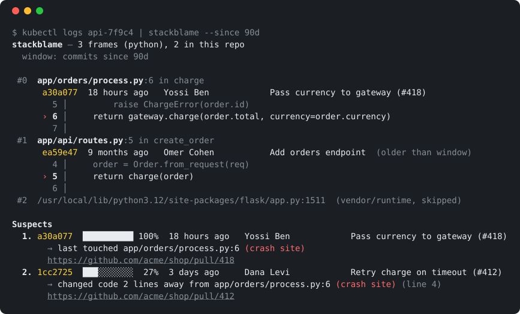

# stackblame

**`git blame` for stack traces.** Paste a crash, get the commits that most likely caused it.

[](https://github.com/AlbacoreTheTuna/stackblame/actions/workflows/ci.yml)
[](https://www.npmjs.com/package/stackblame)
[](LICENSE)


```sh
kubectl logs api-7f9c4 | npx stackblame --since 7d
```



You already do this by hand during every incident: copy a path and line number out of the trace, `git blame` it, squint at the date, repeat for the next frame, then dig through `git log` for anything recent nearby. `stackblame` does all of that in one shot, for every frame, and ranks the result.

- **Works on any trace** — Node/browser JS, Python, Go, Java/Kotlin, Ruby, Rust, PHP, C#, C/C++ (gdb), Dart, Elixir, Perl, plus a generic `path:line` fallback.
- **Finds your files even when the paths don't match** — `/usr/src/app/dist/orders.js` from a container resolves to `src/orders.ts` in your checkout; `com.acme.OrderService` resolves to `services/billing/src/main/java/com/acme/OrderService.java`.
- **Ranks suspects, with reasons** — the commit that last touched the crash line, commits that changed the lines right next to it, commits that touched the file; weighted by how deep the frame is and how recent the change is.
- **Understands incidents** — `--since 7d` for "what changed this week", `--base main` for "what did *my branch* change", `--rev v2.41.0` to blame the code as it was in the deployed build.
- **Zero dependencies, no API key, nothing leaves your machine.** It's `git` + ~700 lines of Node.

## Install

```sh
npx stackblame            # no install
npm i -g stackblame       # or install globally
```

Requires Node 18+ and `git` on your PATH. Run it from anywhere inside the repository the trace came from (or point at it with `-C`).

## Usage

```sh
stackblame crash.txt                         # from a file
pbpaste | stackblame                         # from the clipboard (macOS)
xclip -o | stackblame                        # from the clipboard (Linux)
npm test 2>&1 | stackblame --base main       # straight from a failing command
kubectl logs api-7f9c4 | stackblame --strip /usr/src/app --rev v2.41.0
```

### Options

| Flag | What it does |
| --- | --- |
| `--since <when>` | Only consider commits newer than this. Accepts `7d`, `2w`, `3m`, `12h`, a date, or anything `git log --since` understands. |
| `--base <ref>` | Only consider commits **not** already on `<ref>`. Use `--base main` on a feature branch to ask "did I break this?" |
| `--rev <sha\|tag>` | Blame the code **as of that revision**. Use this when the trace came from a deployed build whose line numbers no longer match `HEAD`. |
| `--strip <prefix>` | Strip a path prefix from trace paths (e.g. `--strip /app`). Repeatable. Usually unnecessary — suffix matching handles most cases. |
| `--top <n>` | Number of suspects to show (default 5). |
| `--context <n>` | Lines of source around each frame (default 1; `0` hides code). |
| `--max-frames <n>` | Frames to analyze (default 25). |
| `-C, --repo <dir>` | Run against this repository instead of the current directory. |
| `--json` | Machine-readable output (see below). |
| `--color` / `--no-color` | Force colors. `NO_COLOR` and `FORCE_COLOR` are respected. |

### Exit codes

| Code | Meaning |
| --- | --- |
| `0` | Analysis completed. |
| `1` | Error (not a git repository, git failed). |
| `2` | Usage error. |
| `3` | The trace parsed, but none of its frames point at files in this repo. |

## How it works

1. **Parse.** Each line of the input is matched against a set of language-specific patterns. Frames are normalized to `{file, line, column, function}` and ordered innermost-first (Python prints them the other way round; chained exceptions are handled).
2. **Resolve.** Each frame's path is mapped to a file in the repo by longest-unique-suffix match against `git ls-files`. Build output (`dist/x.js`) is mapped back to source (`src/x.ts`) and flagged as approximate. Vendor and runtime frames (`node_modules`, `site-packages`, `/rustc/`, `java.*`, …) are skipped.
3. **Blame.** For every resolved frame, in parallel: `git blame` the exact line, `git log -L` over a ±3-line window to find every commit that edited that neighbourhood (and *which* lines each one touched), and `git log -- file` for commits that touched the file at all.
4. **Rank.** Each commit accumulates a score across frames:

   ```
   score = depthWeight(frame) × kindWeight(evidence) × recencyWeight(commit) [× distanceWeight]

   depthWeight    1 / (depth + 1)^0.6      crash site counts most, callers less
   kindWeight     blame 1.0 · changed-this-line 0.7 · changed-nearby 0.55 · touched-file 0.15
   recencyWeight  0.3 + 0.7·e^(−age/45d)   yesterday ≈ 1.0, last year ≈ 0.3
   distanceWeight 1 / (1 + 0.5·d)          for nearby edits, d = lines from the crash line
   ```

   Scores are shown relative to the top suspect (100%). The percentages are a ranking aid, not a probability.

## JSON output

`--json` emits everything the terminal view is built from, so you can feed it to a bot, a Slack message, or a CI comment:

```jsonc
{
  "lang": "python",
  "repo": { "root": "/work/shop", "web": "https://github.com/acme/shop", "head": "…", "rev": null },
  "frames": [
    {
      "depth": 0, "file": "/app/app/orders/process.py", "path": "app/orders/process.py",
      "line": 6, "func": "charge", "status": "suffix",
      "blame": { "sha": "…", "author": "Yossi Ben", "time": 1762541100, "summary": "Pass currency to gateway (#418)",
                 "pr": 418, "prUrl": "https://github.com/acme/shop/pull/418", "code": "    return gateway.charge(…)" },
      "context": [ { "n": 5, "code": "…", "hit": false }, { "n": 6, "code": "…", "hit": true } ]
    }
  ],
  "suspects": [
    { "short": "5fea3de", "author": "Yossi Ben", "ageDays": 0.8, "subject": "Pass currency to gateway (#418)",
      "confidence": 100, "pr": 418, "prUrl": "…", "url": "…",
      "reasons": [ { "kind": "blame", "file": "app/orders/process.py", "line": 6, "depth": 0 } ] }
  ],
  "stats": { "parsed": 3, "analyzed": 3, "resolved": 2, "vendor": 1, "unresolved": 0 }
}
```

It's also available as a library:

```js
import { analyze, parseTrace } from 'stackblame';

const result = await analyze(traceText, { cwd: '/work/shop', since: '7d' });
console.log(result.suspects[0]);
```

## Use it in CI

Turn a red test job into a pointer at the commit to look at. On a pull request, `--base` limits suspects to the PR's own commits:

```yaml
- name: Run tests
  id: tests
  run: npm test 2>&1 | tee test.log
  continue-on-error: true

- name: Who broke it?
  if: steps.tests.outcome == 'failure'
  run: npx stackblame test.log --base origin/${{ github.base_ref }} --no-color
```

Needs `fetch-depth: 0` on `actions/checkout` so the history is available.

## Tips for production traces

- **Line numbers don't match?** The trace came from a different revision. Pass the deployed SHA or tag: `--rev v2.41.0`. stackblame will blame the file *as it was then* and show you the code that was actually running.
- **Compiled JavaScript?** Frames in `dist/` are mapped to their `src/*.ts` siblings and marked *approximate*. Source-map support is on the roadmap; until then, deploy with `--enable-source-maps` (Node 12.12+) and your traces will already point at `.ts` files.
- **Monorepo with duplicate file names?** stackblame prefers the longest matching suffix and warns when a match is ambiguous. Add more path to the trace, or `--strip` the container prefix so the full repo-relative path matches exactly.

## Supported trace formats

| Language | Example line |
| --- | --- |
| Node / V8 | `at charge (/app/dist/orders.js:42:15)` · `at async run (file:///app/x.mjs:9:3)` |
| Firefox / Safari | `charge@http://localhost:3000/static/js/main.js:42:15` |
| Python | `File "/app/orders.py", line 42, in charge` (chained exceptions too) |
| Go | `/go/src/github.com/acme/shop/orders.go:42 +0x1d` (with the function on the line above) |
| Java / Kotlin / Scala | `at com.acme.OrderService.charge(OrderService.java:42)` — package path → file path |
| Ruby | `` /app/orders.rb:42:in `charge' `` · `from /app/x.rb:5:in 'Foo#bar'` |
| Rust | `thread 'main' panicked at src/orders.rs:42:9` · `at ./src/orders.rs:42:9` |
| PHP | `#0 /var/www/src/Orders.php(42): Orders->charge()` · `in /var/www/x.php on line 42` |
| C# / .NET | `at Acme.OrderService.Charge(Order o) in /src/OrderService.cs:line 42` |
| C / C++ (gdb) | `#0 0x0000555555555171 in charge (o=0x0) at src/orders.c:42` |
| Dart / Flutter | `#0 charge (package:shop/orders.dart:42:5)` |
| Elixir | `(shop 0.1.0) lib/shop/orders.ex:42: Shop.Orders.charge/1` |
| Perl | `at /app/orders.pl line 42.` |
| anything else | any `path/file.ext:42[:col]` token on a line |

Missing one? [Open an issue with a sample trace](https://github.com/AlbacoreTheTuna/stackblame/issues/new?template=trace-format.md) — adding a format is usually one regex and one fixture.

## Limitations (honest version)

- It ranks *recent changes near the crash*. That is where the cause usually is, but not always — a config change, a dependency bump, or bad input can crash old, correct code. Treat the output as "look here first", not as a verdict.
- Blame follows git history; squash-merged or rebased history is fine, but a mass reformat commit will own a lot of lines. `--since` and `--base` are your friends.
- Compiled-output mapping is by file name, not by source map, so line numbers are approximate in that case (and flagged).
- Shallow clones have little history to rank against; use `fetch-depth: 0` in CI.

## Prior art

Pinterest's [`git-stacktrace`](https://github.com/pinterest/git-stacktrace) (2016) did "which commits in a range touched these files" for Python and Java traces. stackblame generalizes the idea to a dozen languages, adds path resolution for container and build-output paths, blames the exact line and its neighbourhood, and ranks the result.

## Contributing

See [CONTRIBUTING.md](CONTRIBUTING.md). The quickest way to help: paste a trace format that didn't parse into an issue.

```sh
git clone https://github.com/AlbacoreTheTuna/stackblame && cd stackblame
npm test                    # 50+ tests, builds a real git repo under tmp
node scripts/demo.js --print
```

## License

MIT
